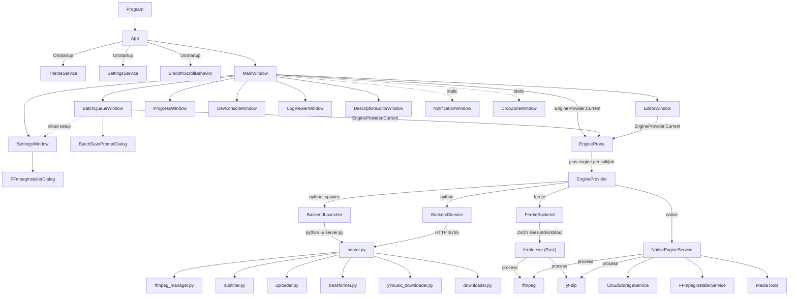

# CLAUDE.md — VideoConverter code map

Read this file before searching. It covers where everything lives and how the parts connect.
Line numbers are approximate (snapshot from 2026-10-09). Grep for the method name if one has moved.

## What the app is

A WPF desktop app (**VideoConverterUI**, .NET 10, `net10.0-windows`, WPF-UI 4.3.0) that downloads videos and audio
from Instagram, TikTok, YouTube and YouTube Music. It can optionally "fingerprint" them (re-encode or change metadata
so platforms don't flag them as duplicates), trim or crop them, generate subtitles, and upload them to cloud storage.
Three interchangeable execution engines do the actual work (setting `execution_engine`):

- **Native** (the default, `"native"`): `Services/NativeEngineService.cs` runs `yt-dlp` and `ffmpeg` as child processes in-process. No YouTube upload.
- **Ferrite** (`"ferrite"`): a 1:1 Rust port of Native in `backend-ferrite/` (Cargo workspace), run as the sidecar `ferrite.exe` and driven by
  `Services/FerriteBackend.cs` over JSON lines on stdin/stdout. Same outputs as Native, plus YouTube upload (token.json compatible with Legacy).
  `backend-ferrite/PORTING.md` is the full spec: API contract, protocol, parity checklist, results.
- **Legacy** (`"python"`, shown as "Legacy", **no longer supported**, not in the installer; only a manual download
  `VideoConverter-Legacy-Python.zip` that users extract as `backend\` next to the exe): a FastAPI server in `backend/server.py` on `http://127.0.0.1:8765`, called over HTTP by
  `Services/BackendService.cs`. YouTube upload via `uploader.py`; no cloud upload (jobs fail with a clear error).
- Subtitles in all engines use faster-whisper from `backend/subtitler.py` (Native and Ferrite call it via `python -c`).

Note: the project was renamed from **ReelsConverter** to **VideoConverter**. Git still lists the old `ReelsConverterUI/` and
`ReelsConverter.slnx` as deleted, and the new `VideoConverterUI/` as untracked. Use only `VideoConverterUI/`.

## Build / run

```bash
dotnet build VideoConverter.slnx
dotnet run --project VideoConverterUI
dotnet publish VideoConverterUI -c Release        # single-file, win-x64, framework-dependent (+ ferrite.exe)
installer/build_release.ps1                        # release for the web installer -> dist/vc (publish + setup + manifest.json + legacy zip)
installer/build_release.ps1 -Upload                # ... and upload to R2 (bucket scash-files, prefix vc/) via wrangler, manifest last
pip install -r backend/requirements.txt            # only needed for the python engine / subtitles

cd backend-ferrite && cargo build --release        # ferrite.exe (the C# build runs this too; /p:SkipFerriteBuild=true skips it)
cd backend-ferrite && cargo clippy --workspace --all-targets -- -D warnings && cargo test --workspace
dotnet run --project backend-ferrite/parity -- golden     # regenerate golden fixtures from the C# code
dotnet run --project backend-ferrite/parity -- e2e        # Native vs Ferrite side by side (downloads!)
dotnet run --project backend-ferrite/parity -- backends   # every feature through all three engines via EngineProvider
dotnet run --project backend-ferrite/parity -- advice     # ErrorAdvisor categories for real error texts, en/de/ru
```

- Distribution: **`VideoConverterSetup`** (web installer, see below) is what users get, from `https://scash.uk/vc`. The old WiX MSI
  (`installer/Package.wxs`, `build_msi.bat`) is superseded; the setup removes an installed MSI (UpgradeCode in `SetupPaths.OldMsiUpgradeCode`).
- Entry point: `VideoConverterUI/Program.cs` → `App` → `MainWindow` (`StartupObject = VideoConverterUI.Program`).
- `backend/ffmpeg_bin/**` and `backend-ferrite/target/release/ferrite.exe` are copied next to the exe. The Python backend is **not** included in the publish output.
- Tests exist only for Ferrite: Rust unit tests, golden tests against C# fixtures (`parity/fixtures/golden.json`) and the parity runner.
- Ignored or local-only: `_backups/`, `scratch/`, `publish/`, `dist/`, `bin/`, `.wix/`, `installer/*.msi`, `backend/client_secret.json`, `backend/token.json`.

## Architecture graph



### Job flow (one URL)
1. `MainWindow.TxtUrl_TextChanged` / `Fetch_Click` → `FetchMetadataAsync` → `IEngineService.FetchMetadataAsync` (or `FetchYTMusicMetadataAsync`). A playlist URL triggers `CheckAndPromptPlaylist`, which opens `BatchQueueWindow`.
2. `MainWindow.Start_Click` (~L1425) → `BeginJobUi` → `IEngineService.CreateJobAsync(...)` returns a job id.
3. `IEngineService.StreamJobAsync(jobId)` yields `JobStatus` (`status` = pending/downloading/processing/uploading/completed/error/cancelled, `progress`, `message`, `result`). Progress is shown by `UpdateMiniProgress` and `ProgressWindow.UpdateProgress`.
4. Native pipeline: `NativeEngineService.ExecuteJobPipelineAsync` (~L535): download (`DownloadVideoWithRetriesAsync` / `DownloadYtMusicAsync`), then `ApplyFingerprintAsync` (~L1124) if enabled, then `CloudStorageService.UploadAsync` if cloud is on. The native engine rejects YouTube upload.
5. Python pipeline: `server.py::_run_job_sync` runs `downloader.download_video`, then `transformer.transform_video`, then `uploader.upload_to_youtube`.

## Persistence

| What | Where | Code |
|---|---|---|
| App settings | `%APPDATA%\VideoConverter\settings.json` (window sizes are not stored) | `SettingsService` (`Current`, `Load`, `Save`, `SettingsChanged` event), model `Models/AppSettings.cs` |
| Theme | `%APPDATA%\VideoConverter\theme.json` | `ThemeService` (`Current`, `Apply`, `SaveDeferred`, `FlushPendingSave`), model `Models/ThemeSettings.cs` |
| Batch session | saved by `BatchQueueWindow.SaveBatchSession` / `RestoreBatchSession` | `BatchSessionData`, `BatchItemDto` (bottom of `BatchQueueWindow.xaml.cs`) |
| Python temp files | `%TEMP%\VideoConverter` | `server.py::_cleanup_stale_temp` |
| YouTube OAuth | `backend/client_secret.json`, `backend/token.json` | `uploader.py::_get_client` |

To add a setting: add a property to `AppSettings` (with a default value) and include it in `Clone()`. Add a row to the right pane in
`SettingsWindow.xaml` and one `Bind*` line in `SettingsWindow.BindControls` (`BindSwitch` / `BindCombo` / `BindIntCombo` / `BindText`): the control loads
from and saves to `SettingsService.Current` on every change (no Save button). Code that depends on it reacts to `SettingsService.SettingsChanged`.

## Theming & resources

- `App.xaml` (~1850 lines) holds every global style: the color palette, toggle switches (Glass / Capsule toggles), the scrollbar, glass TextBox/PasswordBox/ComboBox styles, and buttons (Flat icon, Glass pill, Action, Start). Search for `<!-- ══════ Name ══════ -->` section headers.
- `Assets/FormStyles.xaml`: the Settings form look (`Group`/`GlassGroup`, `Header`, `Footer`, `Row`, `Sep`, `Label`, `Sub`, `Value`, `Switch`, `Push`/`PushPrimary`, `GlassSegmentTrack`/`GlassSegment`, `GlassRoundBtn`), merged into SettingsWindow, EditorWindow and BatchQueueWindow. Use `GlassGroup` for groups that sit on Liquid Glass.
- `ThemeService.Apply` writes brush resources `BgDeep, BgSurface, BgCard, BgElevated, BorderSub, Accent, AccentPink, AccentGrad, TextPrimary, TextSec, SuccessGreen, ErrorRed, HoverBg, ActiveBg, CardHoverBg, PopupBg, PopupBorder, InputBg` (+ aliases). XAML must reference them with `{DynamicResource ...}`. Subscribe to `ThemeService.ThemeApplied` to react to theme changes.
- Light/dark: `ThemeService.IsLight` (from BgDeep luminance), event `ModeChanged`. Per mode it also writes `Tint01`..`Tint80` (white at that alpha in dark, black in light), `ConsoleText`, `TextOnMedia` (always white) and `TextShadowOpacity`, swaps WPF-UI's `Theme/Dark.xaml`/`Light.xaml` and the DWM dark-mode flag. **Never hard-code `#xxFFFFFF` overlays or white text** on themed surfaces: use `{DynamicResource TintXX}` / `TextPrimary`. Hard-coded white is only for things drawn on video/thumbnails or on accent fills.
- `MainWindow.CreateAdaptiveTheme` / `GetDominantColor` tint the UI from the thumbnail's dominant color.
- The theme is edited in Settings (`SettingsWindow.Appearance.cs`), spread over three sidebar panes: **Appearance** (Dark/Light via `ThemeService.DarkMode` / `LightMode` / `WithMode`, no other built-in presets; accent color row, video colors; the per-color editor (HSV, marked beta) is the sub-page Colors; Video colors is a sub-page too), **Glass & Layout** (sub-pages Window glass: opacity and borders; Toolbar buttons; plus layout rows) and **Animations** (motion profile: Reduced/Subtle/Balanced/Fluid/**Liquid**, the default for new installs; sub-page Customize: window opening style (Liquid/Morph/Slide/Zoom/Fade)/spring/speed, hover, cascade, glow). Theme values go through `CommitTheme` (coalesced `ThemeService.Apply` + `SaveDeferred`). There is no separate Theme Designer window, no header button for it and no custom theme presets (`SettingsWindow.SelectPane("appearance")` opens the pane directly).

## Localization

- `Assets/Strings.{en,de,ru}.xaml`: `sys:String` resources (~620 keys, incl. ~220 `ErrAdv_*` error-advice strings). Each file has an `x:Key="LangCode"` entry.
- English always stays loaded as the fallback (`LocalizationService.ApplyLanguage`). A new key **must** go into `Strings.en.xaml`. Add it to `de`/`ru` too.
- XAML uses `{DynamicResource Key}`. Code-behind uses each window's private `L(string key)` helper.

## File map

### Root
| Path | Purpose |
|---|---|
| `VideoConverter.slnx` | Solution (one project) |
| `VideoConverterUI/` | WPF app (all active C# code) |
| `backend/` | Python FastAPI engine (Legacy, optional) |
| `backend-ferrite/` | Ferrite: Rust port of the Native engine (`crates/ferrite-engine`, `crates/ferrite-sidecar` → `ferrite.exe`), `parity/` runner, `PORTING.md` |
| `VideoConverterSetup/` | Web installer (see below) |
| `installer/build_release.ps1` | Builds a release into `dist/vc` and uploads it (`-Upload`) |
| `installer/Package.wxs`, `build_msi.bat` | Old WiX MSI installer (superseded) |
| `Icons/*.ico` | Window icons, linked into the csproj as resources |

### `VideoConverterUI/` — windows (`*.xaml` + `*.xaml.cs`)
| Window | Lines (cs) | Responsibility / key members |
|---|---|---|
| `MainWindow` | 4574 | Main UI. Everything on it is Liquid Glass over `GlassBackdrop` (a copy of the window's background, gradient included, clipped away on screen by an empty Canvas): the header pills and the − / × capsule `WindowControlsGlass` (surface `HeaderPill`, buttons styled `PillGlassBtn`, the language button on `LangPillGlass`), the link field `UrlBarGlass` and the mode toggle's `SegmentTrack` (`UrlBar`), the cards (style `GlassCard`, surface `Card`, no text shadow; the preview card's thumbnail tint is the layer `MetaTint` on the glass, and its glass reflects the thumbnail through a mirrored copy below it as `BackdropOverlay` (`SetupThumbReflection`), the finished-actions card's padding lives on `CompletedActionsHost`) and `StartContainer` (`StartButton`). URL input, mode segments (`Mode_Changed`, `Segment_*`), metadata + thumbnail (`FetchMetadataAsync` ~L1029, `LoadThumbnail`), dominant-color gradient, `Start_Click` ~L1425, mini progress bar (`UpdateMiniProgress`, `OnProgressRenderingFrame`), language pill (`SetLanguage`), header pills (`RefreshHeaderPills` decides every pill, button, divider and label and whether the tools fold into ••• (`ShouldFoldTools`); the items animate through `PillMotion`), dev console commands `HandleConsoleCommand` ~L3485, error popup + friendly errors `GetFriendlyErrorDetailsAndFix` ~L3901, `RestartBackend_Click`, drag-and-drop (`Window_Drop`, `HandleDroppedUrl`), `RunFfmpegExportJobAsync` ~L4472 (export from Editor), easter eggs (`TitleStack_Click`) |
| `BatchQueueWindow` | 2804 | Batch/playlist queue. Title-bar buttons (add links; Options; save & exit; minimize/close; labels follow "Show icon labels") sit on small glass capsules (surface `Button`, backdrop the static `TitleBackdrop`; `OptionsGlass` springs with the options popup; the add-links pill `AddLinksGlass` grows left into the link field `TxtPlaylistUrl` and shrinks to a loading capsule while the links load, then folds away; also on Esc or when left empty: `SetLinkField`); the floating toolbar (`HeaderHost`: select-all circle `ChkSelectAll` (three-state) with the count, clear, quality, cloud, storage bin `BtnToggleSplitStorage`, save folder; the footer status shows total length and a size estimate per quality, `BytesPerSecond`) and footer (`FooterHost`) are Liquid Glass (surface `Toolbar`) over `QueueSection`; their shadows come from plain shapes under the glass, the cards' from three translucent layers (`QueueCardShadow`; a blurred effect per card was expensive while scrolling) (as the parent's effect they were redrawn on every scroll). Bar spacing follows `SizeChanged` (`UpdateBarInsets`). Performance: no endless animations in the item template (a hidden one kept the whole window and its glass redrawing at 60 fps); progress glides on one shared 30 Hz ticker (`GlideStep`). `AddUrlsWithSkeletonPreviewAsync` ~L720, `ProcessQueueItemAsync` ~L2102, concurrency, per-item quality, cloud toolbar, save/restore session, `StoreItem`/`RestoreItem`. Also contains `BatchQueueItemViewModel` (~L2304, INotifyPropertyChanged), `BatchSessionData`, `BatchItemDto` |
| `SettingsWindow` | 909 (+ `SettingsWindow.Appearance.cs`, `SettingsWindow.Previews.cs`) | macOS System Settings layout: sidebar `Nav*` items → `Pane*` panels (`ShowPane`), grouped rows (styles `Group`/`Row`/`Sep`/`Switch`/`Push`). Instant apply via `Commit` + `BindControls`; `HasChanges` tells MainWindow to re-apply on close. MainWindow builds the next one ahead at idle (`PrepareSettingsWindow` → `_settingsSpare`, 3 s after startup and 2 s after each close; building it is ~75 ms), and a click only sets `OriginRect`/`InitialTab`/Owner and shows it: so anything that depends on the moment it opens belongs in `OnLoaded`, not the constructor. The spare is in `Application.Windows` unowned, and `MainWindow_Closing` closes it first or the app wouldn't exit; an unshown Settings window closes without its animation. Developer pane only with Developer Mode (`UpdateDeveloperNav`). General → Software Update (sub-page `PaneUpdate`, opened from the first row of General or `SelectPane("update")`; a red badge on General and that row while an update waits; `SettingsWindow.Update.cs`, `UpdateUpdateUi` from `UpdateService`): Automatic updates + channel on top, then the state centred under the app icon or the update card (More Info… → `PaneRelease` with the manifest's notes, Update Now → confirm sheet); opening the pane re-checks if the last check is over 5 min old. engine switch `ApplyEngineSelection`, alert sheet `ShowSheet` (restart, Reset All, FFmpeg uninstall), FFmpeg status `UpdateFfmpegStatusUi`. Strings use the `Pref*` keys. Sub-pages (Appearance → Liquid Glass `PaneLiquidGlass` (→ Auto Dim, beta, `PaneGlassReadability`: live preview, auto-dim switch, strength slider, how often it checks; `OpenGlassReadability_Click`), → Colors `PaneColors`, → Video colors `PaneVideoColors`; Glass & Layout → Window glass `PaneWindowGlass`, → Toolbar buttons `PaneToolbar`, → Window sizes `PaneWindowSizes` (resize handle + reset); Animations → Customize `PaneMotion`; Cloud → Configuration `PaneCloudConfig` (`SettingsWindow.Cloud.cs`, was the CloudSetupDialog window: Google Drive, Dropbox, OneDrive and Discord as sections under each other, "In Use" on the one Cloud → Service picked, opening with a service scrolls to its section; synced folder rows (Choose… / Automatic, the detected folder shown), Dropbox token + Test, webhook URL + Send Test; all instant-apply; `SelectPane("cloud-config:<provider>")`, which the main window's and Multi Downloader's cloud Setup buttons use through `MainWindow.OpenCloudConfiguration`; the Cloud pane's Configuration row shows the service in use or "Not set up"); About → What's New: one button → `PaneWhatsNew` (`OpenWhatsNew_Click`; loads the notes from the website via `WhatsNewService`, spinner / couldn't load + Try Again / offline note over the saved copy) with one row per big version (27H1, 26H2, v3, v2, v1) → its releases `PaneVersion` (`OpenVersion_Click`) → one release's notes `PaneRelease` (`OpenRelease_Click`); a sub-page can push another, the outer levels wait in `_subPageTrail`). The live previews on them (sample video tint, window over a desktop, mock title bar, motion demo that replays on change) and Notifications' sample banners live in `SettingsWindow.Previews.cs` (`BindPreviews`, `OnPaneShown`) open with `OpenSubPage`/`PushSubPage`, which shows the floating back button `BackGlass` and sets the title `TxtPaneTitle` (every other pane shows its sidebar name there, from `_paneTitles`; `HeaderScrim`, a window-coloured gradient behind it, fades in over the first 32 px of scrolling, `UpdateHeaderScrim`); push/pop slide sideways (`SnapshotContent` freezes the old page into `PageSnapshot`, then `FluidMotion.SlidePage`), and going back restores the parent's scroll position. List them in `IsSubPage` |
| `EditorWindow` | ~950 | Video editor (alpha). Title bar; the preview (`PreviewCard` in `ContentLayer`, nothing drawn over the video but the crop guide); the inspector (right arm) and the timeline + controls row (bottom arm: play/stop/mute, trim, speed/volume chips) are ONE backwards-L Liquid Glass platform (surface `Inspector`, `ReverseLArms="280,86"`, backdrop `ContentLayer`), with the preview in its cut-out. Icon tabs `TabVideo/Audio/Subs/Export` → panes `Inspector*` (grouped rows from `FormStyles.xaml`). `FitWindowToVideo` resizes the window on MediaOpened so the preview takes the video's shape (no bars); after a resize with the corner handle `SnapWindowToVideo` keeps the side dragged more and glides the other into the video's shape (`AnimateWindowSize`). MediaElement playback (`SetPlaying`; a file Windows can't decode, e.g. VP9/Opus WebM, fails or times out in `OnOpenFailed`, which plays an H.264 copy from `BuildPreviewCopyAsync` in %TEMP% instead (same pixel size, deleted on close); subtitles and export keep the original `_filePath`), crop overlay, Space = play/pause, Esc = close, `BuildFfmpegArgs`, which hands off to `MainWindow.RunFfmpegExportJobAsync` |
| `NotificationWindow` | ~540 | Toast. The card is a `LiquidGlassPanel` (surface `Notification`); `SetupGlass` points its `BackdropSource` at the parent window's content. iOS-style spring fly-in from above (`AnimateIn`), flies out upward in `Dismiss`. Banners stack (static `Stack`, newest first, max 4): a new one takes the top place and the older ones slide down (`Restack` → `MoveTo`: the windows stay at the top of the stack and each card springs down inside its own window on `_stackSlide`; the window grows at the bottom first and shrinks once settled, `SetSlideRoom`); a dismissed one's place closes up; the same message again replaces its earlier banner. `NotificationWindow.Show(msg, owner, NotificationType, onClick, actionText, persistent)` (static) |
| `GlassTunerWindow` | ~320 | Developer tool (plain Win32 window): pick a glass surface (`GlassTuning.Surfaces`), slider + number box per `GlassParams` value, per theme mode, applied live; previews (persistent test notification, sample drop-down), Reset / Copy as C# / Save. `ShowTuner(owner)`; opened from Settings → Developer or `debug glass` |
| `ProgressWindow` | 428 | Detailed progress + log. `UpdateProgress`, `MarkDone`, `AppendLog`, `ToggleLog`, `ShowWithAnimation` |
| `DropZoneWindow` | 371 | Floating drop target. Static `ShowZone`, `MorphAwayStatic`, `SetLoadingStatic`, `IsLinkDrag`, `GetDroppedLink` |
| `DevConsoleWindow` | 281 | Developer console. `AppendLog`, `ClearConsole`. Commands are handled in `MainWindow.HandleConsoleCommand` |
| `FFmpegInstallerDialog` | 168 | UI for `FFmpegInstallerService.InstallFfmpegAsync` |
| `BatchSavePromptDialog` | 110 | "Save batch before closing?" prompt |
| `LogViewerWindow` | 105 | Log viewer |
| `DescriptionEditorWindow` | 91 | Edits the description for YouTube upload |

Every window shares the same pattern: `OnLoaded`
(size from settings and an open animation), `TitleBar_Drag`, `OnClosing` → `CloseWithAnimation`, and
`OnSettingsChanged`/`OnThemeApplied` handlers. Popups use `AnimatePopupIn/Out` and `CheckClosePopupsOnOutsideClick`.

### `VideoConverterUI/Services/`
| File | Responsibility |
|---|---|
| `IEngineService.cs` | Engine contract: `WaitForHealthAsync`, `FetchMetadataAsync`, `FetchYTMusicMetadataAsync`, `CreateJobAsync(url, mode, platform, title, description, tags, outputDir, privacy, fingerprint, fingerprintMethod, useGpu, quality, ct, cloudUpload, cloudProvider, cloudTempOnly)`, `StreamJobAsync`, `CancelJobAsync`, `GenerateSubtitlesAsync`, `FetchPlaylistAsync` |
| `EngineProvider.cs` | Static: `Current` (= `EngineProxy`), `ActiveKey`, `NativeKey/FerriteKey/ClassicKey`, `DisplayName`, `InitializeAsync`, `SwitchEngine` (returns false when deferred because the engine is busy), `RestartAsync`, `Shutdown`, events `OutputReceived` / `EngineChanged` / `EngineSwitchDeferred`, `EmitOutput` |
| `EngineProxy.cs` | The `IEngineService` the UI holds; pins the engine for each call and from `CreateJobAsync` until the stream ends; routes stream/cancel by job id |
| `FerriteBackend.cs` | Ferrite engine: starts `ferrite.exe`, JSON-lines protocol (PORTING.md §12), Native-style job channels, host calls (`get_settings`, `ensure_ffmpeg`), crash/restart handling |
| `ErrorAdvisor.cs` | Raw error → category (title, explanation, fix steps from `ErrAdv_{id}_*` strings, main action). Used by the MainWindow error popup, Multi Downloader items and the Editor |
| `NativeEngineService.cs` (1780) | C# engine. `ResolveBinaries` (finds yt-dlp: python module or standalone, `EnsureStandaloneYtDlp`), `EnsureFfmpegReadyAsync`, `ResolveCookiesFile`, metadata via `yt-dlp -J` (`ExtractMetadataViaYtDlpAsync`, `FetchFallbackMetadataAsync`), `ExecuteJobPipelineAsync`, `RetryStrategies` + `DownloadVideoWithRetriesAsync` / `RunYtDlpDownloadAsync`, `DownloadYtMusicAsync`, fingerprint presets dict (~L1110) + `ApplyFingerprintAsync`, `ProbeVideoAsync`, `GenerateSubtitlesAsync`, `FetchPlaylistAsync`, `EmitStatus`, `GetFormatString` |
| `BackendService.cs` | HTTP client for the Python backend (same interface), SSE stream `/api/jobs/{id}/stream` |
| `BackendLauncher.cs` | Kills whatever holds port 8765, finds Python, starts `backend/server.py` with redirected stdio |
| `MediaTools.cs` | `RunProcessAsync`, `FindSolutionDir`, `FindFfmpeg` / `GetFfmpegCandidates`, `GetHardwareEncoderAsync` (NVENC/QSV/AMF detection) |
| `FFmpegInstallerService.cs` | Downloads/installs FFmpeg into the user dir + user PATH. `IsFfmpegInstalled`, `PromptAndInstallIfNeededAsync`, `UninstallFfmpeg` |
| `CloudStorageService.cs` (724) | Providers `gdrive`/`dropbox`/`onedrive`/`webhook`/custom folder. Local sync-folder detection (`Detect*Folder`), `GetProviderStatus`, `UploadAsync`, `CopyFileWithProgressAsync`, `ProgressableStreamContent` |
| `SettingsService.cs` | Settings persistence + window helpers: resize handle (the only way to resize: every window is ResizeMode="NoResize", no edge resizing) (`WindowCornerGrip` in each window, drawn by `Controls/CornerResizeGlyph`: `ApplyResizeGripVisibility`, `HandleGripHover`, `StartWindowResizeBottomRight(window, onDone)` resizes by hand so it works on NoResize windows too; `onDone` gets the relative width/height change when the drag ends), `ResetWindowSizes` (open windows back to the size they opened at), `ApplyScrollbarVisibility`. Window sizes are not saved: every window opens at the size in its XAML |
| `ThemeService.cs` (746) | Theme persistence and resource application (see Theming) |
| `LocalizationService.cs` | `ApplyLanguage(lang)` |
| `UpdateService.cs` | Software Update: reads the web installer's `manifest.json` (`ManifestUrl`), `CompareVersions` ("27H1.26.4" < "27H1.27" < "27H2"), `State`/`Available`/`Changed`; `StartAutomaticChecks` (MainWindow, 8 s after start then every 6 h, while `AutoCheckUpdates`; banner once per release via `NotifiedUpdateVersion`); `InstallAsync` downloads the manifest's setup, checks its SHA-256, starts it with `/update` and closes the main window. Shown in Settings → Software Update (`SettingsWindow.Update.cs`) |
| `BuildInfoService.cs` | Build name/version/channel/commit SHA, and the changelog records (`ChangelogVersion`/`ChangelogRelease`/`ChangelogSection`). The changelog itself is not in the app any more: it is `installer/whatsnew.json`. **On release: add the release at the top of its big version in `installer/whatsnew.json`, then bump `BuildVersion`** |
| `WhatsNewService.cs` | What's New from the website: `https://scash.uk/vc/whatsnew.json` (sends `X-VideoConverter: <version>`; the site gives the file to nothing else), `LoadAsync` (joins a running load, reuses a result for 10 min), `Last`; keeps a copy in `%LOCALAPPDATA%\VideoConverter\cache\whatsnew.json` for offline (`FromCache`) |
| `DwmHelper.cs` | `UpdateDarkMode`: dark title bar for windows with a system frame (Glass Tuner), called by `ThemeService` on mode changes. There is no window blur (acrylic/blur-behind was removed: unreliable on Windows 11); windows are see-through only by the BgDeep alpha (Window glass → opacity) |
| `ClipHelper.cs` | Attached property `CornerRadiusClip` for clipping Borders |
| `SquircleBorder.cs` | Squircle-shaped Decorator |
| `GlassTuning.cs` | `GlassParams` (every glass value) per surface (`GlassSurfaces.Notification`/`Dropdown`/`Popup`/`Dialog`/`Sidebar`/`Button`/`TitleButton`/`Inspector`/`Toolbar`/`HeaderPill`/`UrlBar`/`Card`/`StartButton`, shipped defaults in `Registry`) and mode; `Effective(surface)` applies `ThemeSettings.LiquidGlassTint` (Settings → Appearance → Liquid Glass); `For(surface, light)`, `Current(surface)`, `Changed` event, `Save`/`DeleteSaved` (`%APPDATA%\VideoConverter\glass.json`), `ToCSharp(surface)` |

### `VideoConverterUI/Models/`
| File | Contents |
|---|---|
| `AppSettings.cs` | All user settings: general, YouTube defaults, fingerprint, batch, cloud, engine (`ExecutionEngine`, `UseGpu`, `BackendUrl`), developer, UI pills, window sizes. `Clone()` |
| `ThemeSettings.cs` | Theme colors + animation options. `Clone()` |
| `Models.cs` | Engine DTOs: `MetadataResponse`, `JobCreateResponse`, `JobStatus`, `PlaylistEntry`, `PlaylistInfo` + lenient JSON converters (`FlexibleNullableIntConverter`, `FlexibleDoubleConverter`) |

### `VideoConverterUI/Animations/`, `Controls/`, `Helpers/`
| File | Contents |
|---|---|
| `Animations/FluidMotionNew.cs` (1150) | `AppleSpringEase` + static `FluidMotion`: `MorphOpen/MorphClose` (window open/close; origin math in `MeasureMorphOrigin`), `StaggerIn`, `ShowPanel/HidePanel`, `LiquidGlassCrossfade`, `SlidePage` (iOS push/pop), progress width/glow pulse, `PhaseOut/PhaseIn`, `Expand/CollapseElement`, corner-radius animation. Each entry point hands off to `Liquid` while `Liquid.IsActive` |
| `Animations/LiquidMotion.cs` | **Liquid**, the app's own motion (profile and window style tag `Liquid.Name`). `Spring` (response + damping, SwiftUI-style `WithBounce`; vocabulary `Fade/Exit/Glide/Snappy/Bouncy/Jelly/Press`), `SpringAnimation` (a `DoubleAnimationBase` whose duration is the spring's settle time; starts with a `Velocity`; `Output=Speed` follows a motion's speed for squash/stretch), and static `Liquid`: `To` (springs a property; without `from` it carries on from the running Liquid spring's speed, tracked per object+property; `done` only runs if nothing took the property over), `Follow`, `Arrive`/`Leave` (bloom wide then tall / exit), `Glide` (selection pill: stretches and clears with speed; flick velocity), `Rig` (reuses a scale+translate RenderTransform), plus the motions FluidMotion, `MenuAnimBehavior`, `MicroAnimationBehavior`, `PillMotion`, `NotificationWindow`, `DropZoneWindow` and the Settings sheet hand off to. Header popups (the windows' `AnimatePopupIn/Out`) and drop-downs deliberately keep the pre-Liquid help bubble opening (`DropdownAnimBehavior.PlayBubble` under Liquid) |
| `Animations/PillMotion.cs` | `SetShown(el, show, animate, pop)`: toolbar items grow/shrink sideways via LayoutTransform (pill widths morph, neighbours glide), target state kept on the element. A Liquid Glass pill (Border with `LiquidGlass.Surface`) morphs like a drop instead (`SetGlassShown`: one `Grow` value drives its real width, a round drop while narrower than tall, squash on overshoot, content fading behind the glass). Used by MainWindow's header and the Settings → Toolbar buttons preview |
| `Animations/DropdownAnimBehavior.cs`, `MenuAnimBehavior.cs`, `MicroAnimationBehavior.cs` | Attached `IsEnabled` behaviors (ComboBox dropdown anim, context menu / submenu open anim, hover/press micro-anim) |
| `Animations/SmoothScrollBehavior.cs` | Global smooth scrolling (`Register()` in App) |
| `Animations/MiddleClickScrollBehavior.cs` | Middle-click autoscroll with an anchor adorner |
| `Controls/CornerResizeGlyph.cs` | iPadOS-style corner resize indicator inside each `WindowCornerGrip`: short arc following the window's corner radius (read from `RootBorder` or `CornerRadius`), lens on hover, thicker while dragging |
| `Controls/CollapsibleCard.cs` | `CollapsibleCard` (HeaderedContentControl) + `ExpandPresenter` animated expander |
| `Controls/LiquidGlassPanel.cs` | Reusable Apple Liquid Glass surface (a `Grid`; XAML children sit on the glass, clipped to its squircle). `Surface` = tuning set in `GlassTuning` (rendered via `GlassTuning.Effective`, i.e. with the user's Clear ↔ Tinted setting), re-applied live. `CornerRadius` (NaN = tuned; animatable). Backdrop: `BackdropSource`, or automatically the popup's window (in a Popup) or the Owner's content (in an owned window). Drives its parent's `DropShadowEffect`. `ReverseLArms` (Size) makes it a backwards-L platform (clip, outline and the shader's lens all follow the L). `AdaptiveContrast` (on; users control it in Settings → Appearance → Liquid Glass → Auto Dim: `ThemeSettings.LiquidGlassAutoDim` on/off, `LiquidGlassDimStrength` 0 softer / 0.5 standard / 1 stronger, which scales the contrast targets and the wash depth; `LiquidGlassDimTextOnly` keeps the wash only in cells that text covers, `KeepOnlyBehindText`: TextBlocks by their text's extent, text boxes whole) samples the backdrop (when: `AppSettings.GlassSamplingMode`, same page: "timer" every 0.4 s, "changes" ~90 ms after a scroll / resize / the panel moving, or "both") into a small grid shaped like the panel, works out per sample the least scrim that gives TextPrimary 4.5:1 and TextSec 3:1, and shows a window-coloured scrim through that map as an opacity mask (two layers crossfade) (video counts as bright, since off-screen rendering can't see it). Gives its content children a slight text shadow (`TextShadow`, on by default; dark in dark mode, a white halo in light mode) unless they have an effect of their own. Used by `NotificationWindow`, every ComboBox drop-down (`ComboMenuSurface` in App.xaml, BatchQueueWindow's combo template) and every ContextMenu and submenu (global `ContextMenu`/`MenuItem` styles in App.xaml, surface `Dropdown`) |
| `Controls/LiquidGlass.cs` | Attached `LiquidGlass.Surface` (+ optional `LiquidGlass.Backdrop`, `LiquidGlass.TextShadow`, `LiquidGlass.BackdropOverlay` = `LiquidGlassPanel.BackdropOverlay`: something of the panel's own behind the glass, over the backdrop): turns an existing `Border`/`SquircleBorder` into a LiquidGlassPanel in place (padding → child margin, so code must not set the Border's Padding afterwards; brush → outline; corner radius followed live; a Background set later lies under the glass, unseen; `GetContent` = the moved child). Used on the whole main window (see MainWindow), on every popup flyout (surface `Popup`), the dialog roots (`Dialog`: BatchSavePrompt, FFmpegInstaller; DescriptionEditor deliberately stays a plain window) the Settings alert sheet and the drop zone (`DropZoneWindow`, surface `Notification`) |
| `Controls/GlassContextMenus.cs` | `Register()` (App.OnStartup): text/password boxes build their Cut/Copy/Paste menu from WPF's internal `TextEditorContextMenu+EditorContextMenu`/`EditorMenuItem` (styled by type, WPF-UI has its own), so those types get the app's glass ContextMenu/MenuItem styles; plus a `ContextMenuOpening` class handler that swaps any menu's explicit styles for the app's |
| `Controls/LiquidGlassEffect.cs` | `ShaderEffect` for Apple Liquid Glass (outline `sdShape`: squircle, or the backwards L via `Arms`; saturation, frosted middle, lensing rim sampling `Inset` past the card, colour split, rim light; superellipse edge like `SquircleBorder`). HLSL compiled at runtime via `d3dcompiler_47.dll` (no fxc), ~0.9 s, so `App.OnStartup` calls `Warmup()`: background compile, bytecode cached in `%LOCALAPPDATA%\VideoConverter\cache\liquidglass-<hash>.ps` (new hash when the HLSL changes), then the hardware check + PixelShader creation on UI idle; `TryCreate` returns null without ps_3_0 hardware rendering |
| `Controls/FrostedPanel.cs` | Floating frosted-glass panel (a `Grid`; XAML children sit on the material). `BackdropSource` = element behind it, shown blurred via a live VisualBrush; without it, a translucent material. Currently unused (the Multi Downloader's bars moved to Liquid Glass; the Settings sidebar and its close/back buttons are `LiquidGlassPanel`s, surfaces `Sidebar` and `Button`, with `ContentLayer` (page + slide snapshot) as backdrop; the content area spans under the sidebar so pages slide beneath the glass, `TabContentGrid`'s left margin keeps them beside it at rest; `ClipContentAroundClose` cuts a round hole in the content behind the buttons). Use a viewport-sized element as `BackdropSource` (e.g. the ScrollViewer), not the full scrolled content: very tall VisualBrush sources render wrong on screen Hosting windows inset/clip their scroll content so it only shows under the glass |
| `Helpers/FireSwordCursorHelper.cs` | Custom cursor from `Resources/epic fire sword.ani` |
| `Helpers/EasterEggs/*` | `EasterEggOrchestrator.Toggle` → Snowfall / ChristmasTree / DiscoGlobe / Spider (triggered from `MainWindow.TitleStack_Click`) |

### `backend/` (Python, FastAPI + uvicorn, port 8765)
| File | Contents |
|---|---|
| `server.py` | App + routes: `GET /api/health`, `POST /api/metadata`, `POST /api/ytmusic/metadata`, `POST /api/playlist`, `POST /api/subtitles`, `POST /api/jobs`, `GET /api/jobs/{id}`, `POST /api/jobs/{id}/cancel`, `GET /api/jobs/{id}/stream` (SSE). `_run_job_sync` runs jobs on a ThreadPoolExecutor (`_MAX_WORKERS`). Auto-installs `_DEPS` on start |
| `downloader.py` | yt-dlp: `fetch_metadata`, `download_video` (`_RETRY_STRATEGIES`, aria2c, browser-cookie probing `_cookie_opts_for`, env `YTDLP_COOKIES_FILE`), `fetch_playlist_entries`, `DownloadCancelled` |
| `ytmusic_downloader.py` | `is_ytmusic_url`, `fetch_ytmusic_metadata`, `download_ytmusic_audio` |
| `transformer.py` | `transform_video` (fingerprinting re-encode), `_best_hw_encoder`, `_probe_video`, `_run_ffmpeg` |
| `uploader.py` | `upload_to_youtube` (Google API OAuth via `_get_client`) |
| `subtitler.py` | `generate_subtitles` (faster-whisper → .srt) |
| `ffmpeg_manager.py` | `ensure_ffmpeg` downloads ffmpeg into `ffmpeg_bin/` |

## Web installer (`VideoConverterSetup/`)

A small custom WPF installer on **.NET Framework 4.8** (preinstalled on Windows 10 1903+ / 11), so `VideoConverterSetup.exe` is one
~100 KB file without dependencies. **Never add NuGet packages there** (they would sit next to the exe). It is in `VideoConverter.slnx`.

- Reads `https://scash.uk/vc/manifest.json` (`ReleaseManifest`: version, `files` with path relative to the manifest, size, sha256;
  optional `runtime`, `ffmpeg`, `ytdlp` URL overrides; `minSetup` vs `ReleaseManifest.SetupProtocol`). Written by `build_release.ps1`
  (version from `BuildInfoService.BuildVersion`, runtime major from the csproj TargetFramework). The worker route is `/vc` in the scash.uk repo (`vcDownload`).
- Per-user install, no admin: `%LOCALAPPDATA%\Programs\VideoConverter` (`SetupPaths`). Steps (`InstallerEngine.PlanInstall`, each a `SetupStep` row):
  close a running app, remove the old MSI (UAC), .NET Desktop Runtime if `Microsoft.WindowsDesktop.App` of that major is missing
  (official aka.ms installer, `/install /quiet /norestart`, UAC), every manifest file (download → `.partial` → SHA-256 check → replace),
  FFmpeg into `%LOCALAPPDATA%\VideoConverterfmpegin` if missing and yt-dlp into `...in\yt-dlp.exe` (both the paths the app looks in;
  failures there are warnings because the app can fetch them itself), then a copy of the setup, Start menu / desktop shortcuts and the
  HKCU uninstall entry (`Files` lists installed names).
- Running it again = update/reinstall (same folder). `VideoConverterSetup.exe /uninstall` (the Apps entry) removes files, shortcuts and the
  entry, optionally settings + tools; the exe deletes itself afterwards (`ScheduleSelfDelete`).
- Switches: `/manifest=<url|local path>` (test against `distc\manifest.json`), `/dir=<path>`, `/keepmsi`, `/noupdate`,
  `/update` (the app's Software Update: over an existing install it skips Welcome, installs with the same folder/shortcuts and
  reopens the app ~1.6 s after "up to date" unless there are warnings; without an install it is a normal setup). Log: `%TEMP%\VideoConverterSetup.log`.
- The manifest's optional `notes` (`[{title, items[]}]`) are the release's sections from `installer/whatsnew.json` (every release's
  notes, `{versions: [{name, channel, releases: [{version, date, sections: [{title, items}]}]}]}`, newest first). Setups ignore them;
  the app shows them under Software Update → More Info. `build_release.ps1 -Upload` also uploads `whatsnew.json` (before the manifest)
  for the app's What's New; `-WhatsNewOnly` uploads just that file (fix notes without a release). The scash.uk worker serves it only
  with the `x-videoconverter` header (`VC_APP_ONLY`).
- Self-update (`SelfUpdate.cs`): the manifest's `setup` entry is the current setup exe; a Release setup whose own SHA-256 differs downloads
  it to `%TEMP%\VideoConverterSetup-update\` and starts it with the same arguments + `/updated`, then closes (still in the cube). Debug builds,
  `/updated` and `/noupdate` skip it; any failure just carries on with the running setup. Setups built before this feature don't have it.
- Run test commands from PowerShell, not Git Bash: MSYS rewrites `/keepmsi`-style arguments into paths.
- The setup exe is unsigned, so SmartScreen warns on first download ("More info → Run anyway").

## Conventions & gotchas
- Files next to the exe (ferrite.exe, ffmpeg_bin, yt-dlp, backend): use `MediaTools.AppDir`, **never** `AppDomain.BaseDirectory` / `AppContext.BaseDirectory`. The single-file publish (`IncludeAllContentForSelfExtract`) extracts itself to `%TEMP%\.net\VideoConverterUI\<hash>\`, and BaseDirectory points there; it only fits content bundled into the exe (the cursor `.ani`). Dev builds hide the bug because both folders are the same.
- A `Popup` declared inside a title bar routes its clicks up to the title bar's `TitleBar_Drag`: skip those with `SettingsService.IsFromPopup(this, e.OriginalSource)` before `DragMove()`. Pop-ups and modal dialogs are never movable.
- Code-behind only: no MVVM framework. The exception is `BatchQueueItemViewModel`. Windows are created with `new XWindow { Owner = this }` from `MainWindow`.
- UI code calls the engine only through `EngineProvider.Current` (`IEngineService`), never through a concrete engine class. A new engine capability has to be added to `IEngineService`, `NativeEngineService`, `FerriteBackend` (+ the Rust engine and a protocol method in `ferrite-sidecar/src/protocol.rs`) **and** `BackendService` (plus a `server.py` route), and `EngineProxy` must forward it.
- Ferrite must stay 1:1 with Native: change both together, regenerate golden fixtures (`parity -- golden`) and rerun `parity -- e2e`. .NET/Win32 behaviour the engine depends on lives in `ferrite-engine/src/dotnet/`.
- Errors shown to users go through `ErrorAdvisor`; a new error text from an engine should get a matching rule (and `ErrAdv_*` strings in en/de/ru), checked with `parity -- advice`.
- A WPF-UI `SymbolIcon` that is a Button's whole content can draw black until the theme is re-applied, whatever its Foreground: wrap it in a `<Grid>` (MainWindow does this for every bare icon button).
- On a `LiquidGlass` Border, `Child` is the glass, not your content: code that walks a card's rows must use `LiquidGlass.GetContent` (`FluidMotion.ContentRows` does this for the crossfades/ShowPanel), or it animates the glass layers.
- Performance (measured on a 164 Hz screen): every window is layered (AllowsTransparency), so each frame anything changes in one costs ~1-2 ms on WPF's render thread, and moving or resizing a window waits for the frame in flight in *any* window: never animate a window's `Top`/`Left`/size frame by frame, move content inside it. A `VisualBrush` renders its whole source again every frame its area redraws; `LiquidGlassPanel` therefore caches a backdrop from another window (popup, banner, dialog) in a BitmapCache'd `_picture` and shifts that picture while the panel moves or scales (`AimBrush`), aiming the brush anew only past `PictureMargin`. Same-window backdrops stay uncached: AdaptiveContrast's off-screen samples render in software, where every BitmapCache is drawn at full size (a sample over the main window went from ~7 to ~45 ms).
- Liquid Glass: transient surfaces (popups, dialogs, sheets, menus) are glass. For a Border that is already there, add `controls:LiquidGlass.Surface="Popup"` (or `Dialog`); for something new, put it in a `LiquidGlassPanel` with a new `Surface` name and add its defaults to `GlassTuning.Registry`; it then shows up in the Glass Tuner. Tune live there, then bake values in with "Copy as C#".
- All animation goes through `FluidMotion` / storyboards and respects the animation level in `ThemeSettings`. `EnablePerformanceMode` swaps in a flat theme. A new animation also gets a Liquid version: `if (Liquid.IsActive) { Liquid...; return; }` using `Liquid.To`/`Arrive`/`Leave` (no fixed durations; let interrupted springs carry on instead of restarting from a `from`).
- Comments are partly German (e.g. in the csproj).
- Large files (`MainWindow.xaml.cs`, `App.xaml`, `BatchQueueWindow.*`, `SettingsWindow.*`): read them in ranges around the line hints above instead of reading the whole file.
