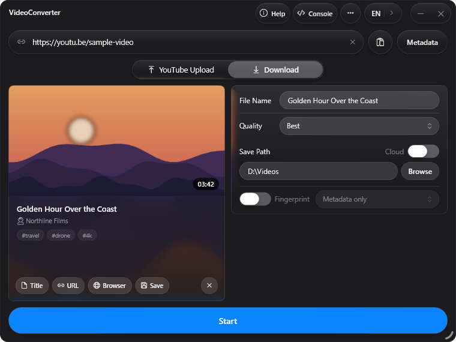
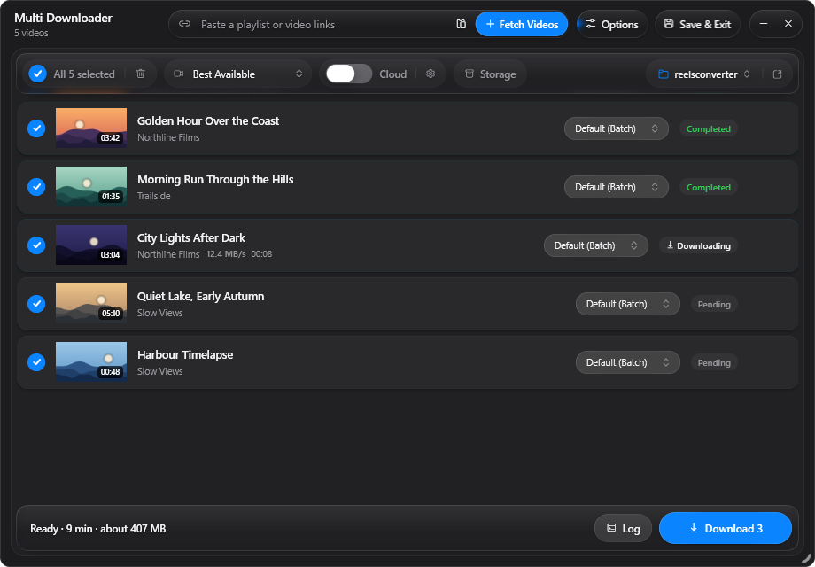
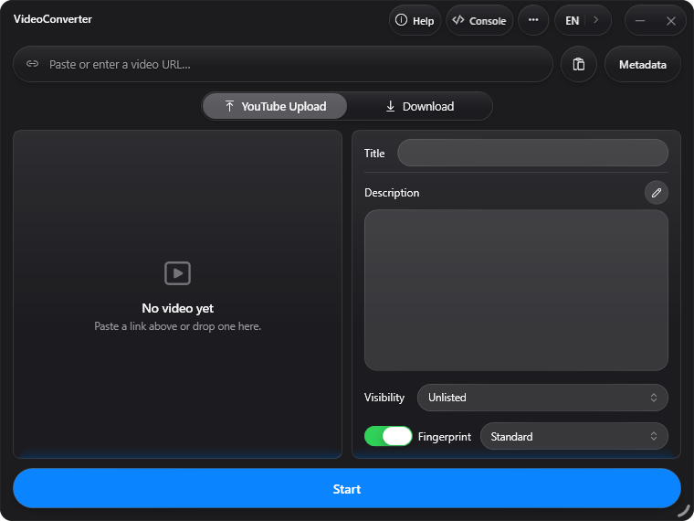
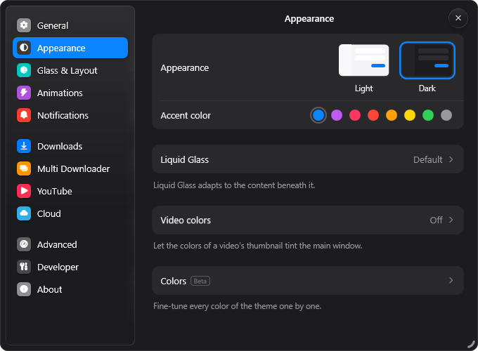

# VideoConverter

A Windows desktop app for downloading video and audio from YouTube, YouTube Music, Instagram and TikTok and others.

<p align="center">
  
</p>

## Download

Get **[VideoConverterSetup.exe]([https://scash.uk/vc](https://github.com/scash231/VideoConverter/releases/download/27H1/VideoConverterSetup.exe))** and run it.

Setup installs the app for your Windows user and fetches what it needs, including FFmpeg and yt-dlp. It only asks for administrator rights if the .NET runtime has to be installed. Run it again to reinstall, or update from inside the app under Settings > General > Software Update.

The setup is not code-signed, so Windows SmartScreen may warn you the first time. Choose **More info**, then **Run anyway**.

Requires Windows 10 version 1903 or later, or Windows 11 (64-bit).

## Features

- **Video:** up to 4K, down to 480p
- **Audio:** MP3, M4A and FLAC, with artist, album and year from YouTube Music
- **Multi Downloader:** queue playlists or lists of links, with a quality setting per item
- **Editor:** trim, crop, speed and volume, plus generated subtitles
- **Fingerprinting:** optionally re-encode a video or rewrite its metadata
- **Cloud:** send finished files to Google Drive, Dropbox, OneDrive or a Discord webhook
- **YouTube upload:** publish directly with your own Google API credentials
- **Languages:** English, German and Russian

## Screenshots

<p align="center">
  
</p>

<table>
  <tr>
    <td width="50%"></td>
    <td width="50%"></td>
  </tr>
</table>

## Build from source

You need the [.NET 10 SDK](https://dotnet.microsoft.com/download/dotnet/10.0) and a [Rust toolchain](https://rustup.rs/).

```bash
git clone https://github.com/scash231/VideoConverter.git
cd VideoConverter
dotnet run --project VideoConverterUI
```

Subtitles also need Python with the packages from `backend/requirements.txt`.

## Project layout

| Path | Contents |
| --- | --- |
| `VideoConverterUI/` | The WPF app (C#) |
| `backend-ferrite/` | Ferrite download engine (Rust) |
| `backend/` | Subtitle generation and the legacy Python engine |
| `VideoConverterSetup/` | Web installer |

## Legal

Only download content you own or have permission to use, and follow the terms of the platform it comes from.
